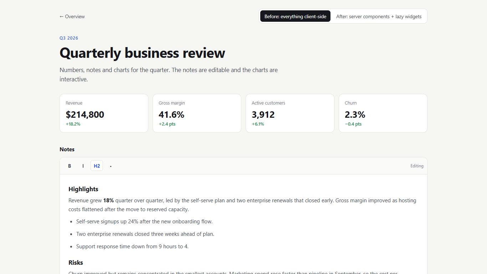
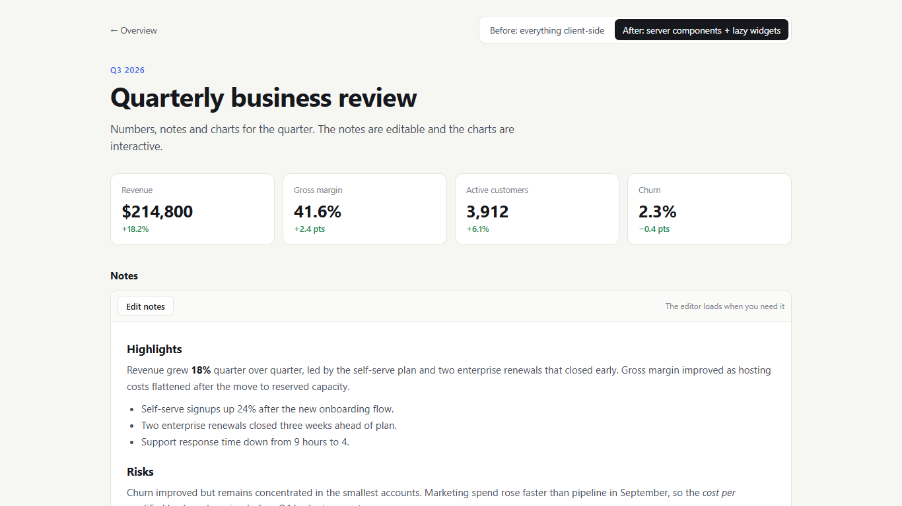

# Heavy widgets in Next.js: server components and lazy loading

**Live demo:** https://the-blackshadoww.github.io/nextjs-heavy-widgets/

A report page with a rich text editor ([Tiptap](https://tiptap.dev)) and charts ([Recharts](https://recharts.org)), built twice in the Next.js App Router. **Before**, the whole page is a client component. **After**, it is a server component, and the editor and charts load only when the user needs them. Same content, same features.

| Before | After |
| --- | --- |
|  |  |

## Results

Measured in Chromium by [`scripts/measure.mjs`](scripts/measure.mjs) against the production build, served with gzip, at a 1366×768 viewport (a common laptop screen).

| On page load | Before | After |
| --- | --- | --- |
| JavaScript downloaded (gzip) | 378 KB | **142 KB** (−62%) |
| Main-thread blocking, 4× slower CPU | 745 ms | **173 ms** |
| Largest contentful paint, 4× slower CPU | 1,112 ms | **204 ms** |

| Later, only if the user needs it | Before | After |
| --- | --- | --- |
| JavaScript after scrolling to the charts | 378 KB | 252 KB |
| JavaScript after opening the editor too | 378 KB | 364 KB |

Even a user who uses every feature downloads less on the After page, because it loads only the 8 editor extensions it uses instead of the full StarterKit. Raw numbers are in [`docs/results.json`](docs/results.json). The 4× slowdown uses Chrome's CPU throttling to approximate a typical laptop or phone. On a taller screen the charts sit within 200 px of the fold, so they load right away; that is intended.

## What runs where

| Part | Where | Why |
| --- | --- | --- |
| Layout, headings, KPI cards | Server component | Static. Renders to HTML, ships no JavaScript. |
| Data fetching (`getReport()`) | Server component | Runs on the server; the widgets get the data as props. |
| Notes text | Server component | Rendered as HTML, so it is readable before any editor code loads. |
| [`EditorSlot`](components/after/EditorSlot.tsx) | Client component | Needs state and events: swaps the HTML for the editor on demand. |
| [`ChartsSlot`](components/after/ChartsSlot.tsx) | Client component | Needs an IntersectionObserver to know when the charts are near. |
| Editor and charts | Client, separate chunks | Need the browser. Loaded with `next/dynamic`, `ssr: false`. |

## How the heavy parts load

- **Editor:** the notes render as plain HTML from the server, with an **Edit notes** button. Hovering or focusing it starts the download early; clicking swaps in the editor with the cursor in place. Only the extensions the page uses are imported ([`LeanEditor`](components/editor/LeanEditor.tsx) vs [`FullEditor`](components/editor/FullEditor.tsx)).
- **Charts:** an IntersectionObserver with a 200 px margin loads the charting chunk just before the charts scroll into view.
- **No layout shift:** both widgets show a skeleton of the same size while they load.

Compare [`app/before/page.tsx`](app/before/page.tsx) with [`app/after/page.tsx`](app/after/page.tsx).

### Trade-offs

- The first click on **Edit notes** waits for the editor chunk on a slow network. Preloading on hover and focus hides most of that wait.
- If almost every visitor edits right away, the editor should load on idle instead of on intent.
- `ssr: false` means the widgets themselves are never in the server HTML. That is fine here because the notes and the KPIs, the important content, are server-rendered.

## Run it

```bash
npm install
npm run dev
```

To reproduce the numbers:

```bash
npm run build
CHROME="/path/to/chrome" npm run measure
```

`DETAIL=1` also prints every script downloaded and at which step.

Built with Next.js 16, React 19, TypeScript, Tiptap 3 and Recharts 3, deployed as a static export to GitHub Pages. Built by [Ashikur Rahman](https://ashikurrahman.vercel.app) with Claude Code. Companion to [the 5,000-row table demo](https://github.com/The-BlackShadoww/table-filter-perf).
